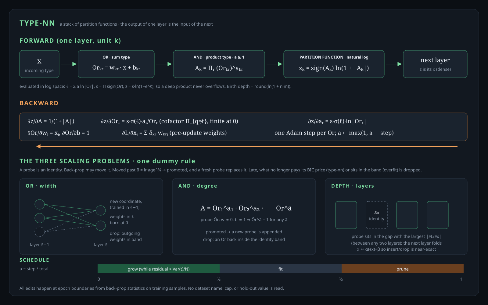
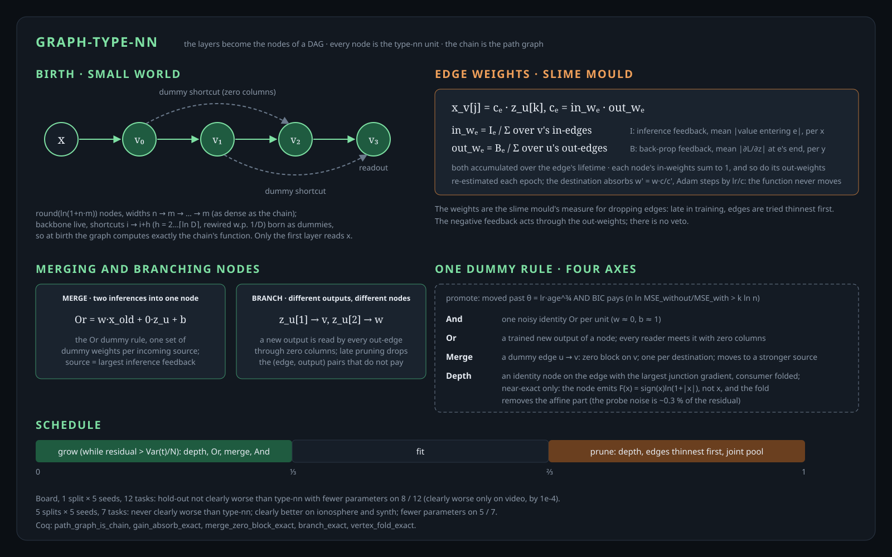

# type-nn

See [ARCHITECTURE.md](ARCHITECTURE.md) for the high-level design of type-nn and its variants (chain and graph), and [PLAN.md](PLAN.md) for the audit and what is still open.


A neural network whose layers are partition functions. The algebra is the
one in [Type Mechanics](https://hadilq.com/posts/type-mechanics/): a type
is a generating function, an **Or** is a sum type, an **And** is a product
type, and the assembly index comes from
[assembly theory](https://en.wikipedia.org/wiki/Assembly_theory). The
activation is the natural log. Width, degree and depth are not chosen by
hand: they are the three scaling problems the network solves while it
trains.

**Read the post:** [Train the knowledge](https://hadilq.com/posts/train-the-knowledge/).
It explains why a hierarchy of partition functions is our knowledge of the
data, and it carries the typeset math: the forward and backward pass, the
threshold, the evidence rule, and an appendix with every equation this
README writes in plain text.

The goal is to beat the `c-mlp` baseline on the board by finding a more
general and better-optimised scaling strategy, without caps or constants
tuned to the current data sets. For the graph variant, the goal is
type-nn's hold-out error with fewer parameters.

The board has three type-nn models. They share the unit, the three
scaling problems and the dummy rule:

| model | files | strategy |
|---|---|---|
| **graph-type-nn** | `type_nn_graph.c/h` | type-nn when the layers are the nodes of a DAG. It is born as the chain plus small-world shortcuts born as dummies. Edges carry slime-mould weights (inference feedback → in-weights, back-prop feedback → out-weights, each summing to 1 per node). Merge, Or, And and depth dummies follow type-nn's evidence rule; edges are dropped thinnest first. See [ARCHITECTURE.md](ARCHITECTURE.md) §5. |
| **type-nn** | `type_nn.c/h`, `type_nn_scale.c/h` | The chain (a linked list of layers). Knowledge changes only on significant evidence: a structure is kept, or promoted, only while it pays the Bayesian-information price of its parameters, measured on the training data. |
| **type-nn-overfit** | `type_nn_overfit*.c/h` | Frozen reference. Probes are promoted on displacement alone and dropped only when they fall back to identity. |





## Architecture

Layer ℓ maps an input vector x (width n_ℓ) to an output vector z (width
m_ℓ). Output unit k is one And over its Ors r:

```
Or_kr = w_kr · x + b_kr                  sum type, dense over x
A_k   = Π_r  Or_kr ^ a_kr                product type
z_k   = sign(A_k) · ln(1 + |A_k|)        partition function
```

- **Dense.** The output of one layer is the input of the next
  (n_{ℓ+1} = m_ℓ), and every Or reads every incoming coordinate, so a
  type-nn stack is as dense as an MLP.
- **Assembly index.** `a_kr ≥ 1` is how many times the sub-object `Or_kr`
  is used to assemble `A_k`. It is learned as a real number, with
  `o^a := sign(o)·|o|^a`, so `sign(A_k)` is the product of the Ors' signs.
  Its floor is 1 (a factor present at least once); removing a factor is a
  structural drop, not `a → 0`.
- **Partition function** on every layer, the output layer included. There
  is no temperature and no special case for hidden layers.
- **Birth.** `round(ln(1 + n·m))` layers, `n → m → … → m`, where n is the
  input width and m the output width. Every unit starts as a single random
  Or (a degree-1 And), with the same init law as `c-mlp`.
  - xor 1, iris 3, wine 4, wdbc 3, diabetes 2, ionosphere 4.

The forward pass runs in log space so a deep product never overflows:

```
ℓ_k = Σ_r a_kr · ln|Or_kr|        s_k = Π_r sign(Or_kr)        z_k = s_k · ln(1 + e^ℓ_k)
```

## Backward

```
∂z/∂A     = 1 / (1 + |A|)
∂z/∂Or_r  = s · σ(ℓ) · a_r / Or_r      (dz/dA times the cofactor; finite as A → 0)
∂z/∂a_r   = s · σ(ℓ) · ln|Or_r|
∂Or/∂w_j  = x_j      ∂Or/∂b = 1      ∂Or/∂x_j = w_j
```

σ is the logistic function. At `Or_r = 0` exactly, the slope is the
cofactor if `a_r = 1` and 0 if `a_r > 1`.

Every gradient is taken with the pre-update weights. Then each Or takes
one Adam step, and a is projected back to `a ≥ 1`. `make test` checks
every gradient against central finite differences (the error falls as h²).

## The three scaling problems

All three follow one dummy rule. A **probe** is an identity, and back-prop
is free to move it. A probe that back-prop moved out of the identity is
**promoted**, and a fresh probe takes its place. Late in training,
structure that is not worth keeping is **dropped**. How "worth keeping" is
decided is the one thing the two models do differently.

| axis | probe (scale up, early) | drop (scale down, late) |
|---|---|---|
| **Or**: width | The layer before grows a new output coordinate (a trained unit). The current layer meets it with weights born at exactly 0, so the function does not move. | Remove the coordinate and its column. |
| **And**: degree | Each And carries one identity Or (`w ≈ 0`, `b ≈ 1`); `1^a = 1` for every a. A promoted probe is replaced by a fresh one. | Remove the Or. Every And keeps at least one Or. |
| **Depth**: layers | One identity layer (unit k is the carrier `Or = x_k`) sits in the gap with the largest mean `\|∂L/∂x\|`. That gap can be between any two layers, not only at the ends. An unpromoted probe moves to the loudest gap each epoch. | Remove the layer. The output layer is never removed. |

**Near-exact depth edits.** A type-identity layer emits
`F(x) = sign(x)·ln(1 + |x|)`, which equals x only to first order. When one
is inserted, the next layer's columns absorb the best affine fit
`x ≈ α·F(x) + β`, measured on the epoch that just ran. When one is
removed, they absorb the reverse fit. Coq `fold_exact` proves this is
exact whenever the fit is.

All edits happen at epoch boundaries and never read the hold-out set.

### Schedule and growth gate

- **Phases.** With `u = step / total`: **grow** on `u < 1/3`, **fit** on
  the middle third, **prune** on `u ≥ 2/3`.
- **Growth gate.** Growth also needs an *unexplained residual*: the
  epoch's training MSE must exceed `Var(t) / N`, the constant predictor's
  loss divided by the number of training samples.
  - The model reads the targets from its own gradient,
    `t = y − m·∂L/∂y`.
  - Without the gate, Adam's scale-invariant steps on vanishing gradients
    look like "back-prop wants this probe"; one XOR seed grew to 1,464
    parameters that way.

### Dynamic threshold

Under per-sample Adam with step η, T steps of zero-mean gradient noise
move a parameter about `η·√T`. A one-signed gradient moves it up to `η·T`.
A probe of age T counts as *moved* when its RMS distance from the
identity exceeds the geometric mean of the two:

```
θ(T) = η · T^(3/4) = sqrt( η·√T · η·T )          (Coq: threshold_geometric_mean)
```

Noise falls behind θ as the probe ages. It is computed from the run
(η and age) in `tnn_threshold_up`, and both models use it for promotion.
**type-nn-overfit** also drops anything back inside the band θ(N), with
N the number of training samples (`tnno_threshold_band`).

### The prior of knowledge (type-nn)

type-nn-overfit keeps any structure back-prop moved. type-nn adds a
prior: a structure must be worth its parameters. For an item with k
parameters (an Or, a coordinate, or a layer), on `n = N·m` training
observations, it must satisfy the Bayesian information criterion:

```
n · ln( MSE_without / MSE_with )  >  k · ln n
```

- **Measured, not estimated.** `MSE_without` comes from resetting the item
  to its identity (an Or to `w=0, b=1, a=1`; a coordinate to a zero
  outgoing column; a layer to its carrier) and re-evaluating the training
  pairs back-prop saw in the epoch. Because the ablation *is* the
  identity, removing an item that failed is exact.
- **Grow.** A probe is promoted when it moved past θ(T) **and** passes the
  criterion. Otherwise it stays a probe and keeps training.
- **Prune.** Every Or and coordinate is a candidate. They are ablated in
  order of the damage each does alone. The ablated set keeps growing while
  the model criterion `C = n·ln(MSE) + K·ln n` (K = all parameters) stays
  at or below its best value seen while pruning.
- **Layers.** At most one per boundary. A layer is removed on trial with
  the fold, measured, and restored if C would rise.

Each part came from a measured failure:

- **Estimates were too far off.** Reading the damage from Adam's second
  moment (the empirical Fisher) was off by 10–20× per Or. Greedy pruning
  on those estimates collapsed iris, wine and XOR.
- **A single epoch's MSE is noisy.** Judging a boundary against that
  epoch's own MSE let one Adam loss spike license a drop from 162 to 74
  parameters.
- **The criterion alone starves growth.** Requiring it without the
  displacement test blocked promotion, because a one-epoch-old probe is
  near identity and cannot show evidence yet.
- **Stricter noise estimates broke XOR.** An unbiased variance
  `RSS/(n−K)`, or a noise floor `Var(t)/N`, in the criterion made XOR
  unlearnable: 4 observations cannot justify any XOR model.

The evidence rule runs forward passes over the training samples. It never
reads the hold-out.

### Constants that remain, and why

| constant | where | status |
|---|---|---|
| Adam β₁, β₂, ε and `TNN_LR_SCALE` = 0.1 | `common.h` | Shared by all models; cannot favour one. |
| task epochs and lr | `bench.c` | Fixed per task and shared by all models. |
| schedule thirds, 1/3 and 2/3 | both `*_scale.c` | The least-informative split. A candidate for a dynamic schedule. |
| exponent 3/4 | threshold | Derived (geometric mean), not fitted. |
| BIC price `k·ln n` | `type_nn_scale.c` | The standard criterion; n, k and the MSE come from the run. |
| probe noise amplitude η | probes | One Adam step, the smallest meaningful move. |
| `a ≥ 1` | assembly index | The definition of a factor that is present. |
| `c-mlp` hidden width 8 / 16 | `c_mlp.c` | The baseline's fixed definition. type-nn never reads it. |
| small-world birth `H = ⌈ln D⌉`, rewiring `p = 1/D` | `type_nn_graph.c` | Derived from the birth depth D; with D ≤ 8 this means "a few skip edges", nothing more. |
| edge-weight absorption and Adam step `lr / c` | `type_nn_graph.c` | Not a constant: makes the edge weight a reparameterisation of both the function and the optimiser (Coq `gain_absorb_exact`). |

There is no width cap, degree cap, depth cap, top-k, or per-dataset table.

## Board

`./bench.sh` writes [BOARD.md](BOARD.md). Every model goes through one
harness (`bench.c`) with the same protocol:

- The same 70/30 splits, with standardisation fitted on each split's
  training rows only. `TNN_SPLITS` sets how many (split 0 is the
  historical seed 34972).
- The same per-epoch shuffle, per-sample Adam (`common.h`), mean-MSE
  gradient `(y − t)/m`, epochs, lr and readout F.
- `TNN_SEEDS` initialisation seeds per split. Verdicts are paired over
  splits when there are several, otherwise unpaired over seeds.
- `params` counts every learnable scalar present after training: dense,
  with nothing skipped for being small.
- `c-mlp-matched` is the widest c-mlp whose params do not exceed
  graph-type-nn's mean on that task, so "fewer parameters" is also
  checked against an MLP of the same size.

The data: the UCI files and the generated `mnist_*.bin` / `video_*.bin`
sets are fetched and built by `flake.nix` (`nix develop` exports
`TYPE_NN_DATA`). They are not committed.

The per-task epochs and learning rates are fair: they belong to the
task, like the data, and every model gets the same values.

### All twelve tasks (`./bench.sh`: 1 split × 5 seeds)

Hold-out MSE, mean ± sd over seeds. "clear" means the gap exceeds two
standard errors.

| task | graph-type-nn | type-nn | c-mlp | c-mlp-matched | graph vs type-nn | params graph / type-nn / c-mlp |
|---|---|---|---|---|---|---|
| xor (fit only) | train 0.0000 | train 0.0000 | train 0.0000 | train 0.0501 | — | **24.8** / 26.4 / 33 |
| iris | 0.0218 ± 0.0065 | 0.0215 ± 0.0069 | 0.0280 ± 0.0061 | 0.0315 | within noise | 80.6 / 125 / **67** |
| wine | **0.0184 ± 0.0039** | 0.0277 ± 0.0048 | 0.0234 ± 0.0056 | 0.0261 | **graph clearly better** | **166** / 170 / 275 |
| wdbc | 0.0398 ± 0.0035 | 0.0448 ± 0.0048 | 0.0438 ± 0.0017 | 0.0467 | within noise | **128** / 163 / 513 |
| diabetes | 0.0332 ± 0.0012 | 0.0329 ± 0.0010 | 0.0488 ± 0.0042 | 0.0353 | within noise | **18.8** / 20.4 / 193 |
| ionosphere | 0.0862 ± 0.0209 | 0.0886 ± 0.0111 | 0.1461 ± 0.0155 | 0.1478 | within noise | 221 / **154** / 577 |
| spambase | 0.0570 ± 0.0050 | 0.0597 ± 0.0055 | 0.0534 ± 0.0016 | 0.0549 | within noise | 335 / **318** / 945 |
| synth | 0.0862 ± 0.0090 | 0.0919 ± 0.0253 | 0.1179 ± 0.0053 | 0.1210 | within noise | 135 / **80** / 289 |
| mnist | 0.0837 ± 0.0038 | 0.0863 ± 0.0040 | **0.0382 ± 0.0017** | 0.0832 | within noise | **231** / 244 / 3322 |
| mnist_large | **0.0158 ± 0.0011** | 0.0160 ± 0.0010 | 0.0228 ± 0.0002 | 0.0225 | within noise | 4913 / 6095 / **3322** |
| video | 0.0001 ± 0.0001 | **0.0000 ± 0.0000** | 0.0004 ± 0.0001 | 0.0005 | type-nn clearly better, by 1e-4 | **529** / 823 / 4129 |
| video_large | 0.0645 ± 0.0014 | 0.0678 ± 0.0030 | **0.0623 ± 0.0016** | 0.0711 | **graph clearly better** | **392** / 407 / 4129 |

- **The goal is met on 8 of 12 tasks.** On xor, iris, wine, wdbc,
  diabetes, mnist, mnist_large and video_large, graph-type-nn is not
  clearly worse than type-nn and has fewer parameters (0.64–0.98×). It is
  clearly better on wine and video_large.
  - It misses on ionosphere (1.44×), spambase (1.05×) and synth (1.70×),
    where it uses more parameters at an equal hold-out.
  - It also misses on video: 1e-4 worse at 0.64× the parameters, with
    both near zero.
- **Against an MLP of its own size.** graph-type-nn is clearly better
  than `c-mlp-matched` on 7 of the 11 hold-out tasks and within noise on
  the other 4. It also fits xor, which the matched MLP does not (train
  0.05).
- **Against c-mlp.**
  - graph-type-nn is clearly better on wdbc, diabetes, ionosphere,
    synth, mnist_large and video, and within noise on iris, wine and
    spambase.
  - It is clearly worse on mnist and video_large.
  - It has fewer parameters on 10 of 12 tasks; iris (1.20×) and
    mnist_large (1.48×) are the exceptions.
- **mnist is a size problem, not a unit problem.** Every type-nn model
  stops at about 230–380 parameters (15 epochs, so a 5-epoch grow
  phase), and a c-mlp of that size (`c-mlp-matched`, 217 parameters)
  scores the same 0.083. With more data (mnist_large) type-nn and the
  graph grow to about 5–6k parameters and beat c-mlp clearly.

### Seven tasks with repeated splits (`TNN_SPLITS=5 TNN_SEEDS=5`)

25 runs per cell, with verdicts paired over the splits. These are the
tasks that run in minutes; the five larger ones were not re-run this
way.

| task | graph-type-nn | type-nn | graph vs type-nn | params graph / type-nn |
|---|---|---|---|---|
| xor | train 0.0000 | train 0.0000 | — | 24.8 / 26.4 |
| iris | 0.0217 | 0.0242 | within noise | 69.9 / 94.1 |
| wine | 0.0173 | 0.0159 | within noise | 139 / 213 |
| wdbc | 0.0366 | 0.0369 | within noise | 109 / 147 |
| diabetes | 0.0323 | 0.0323 | within noise | 19.1 / 19.1 |
| ionosphere | **0.1042** | 0.1137 | **graph clearly better** | 100 / 135 |
| synth | **0.0753** | 0.0853 | **graph clearly better** | 115 / 80 |

On one split, ionosphere and synth are within noise. With five splits
paired, the graph is clearly better on both, and it uses fewer
parameters on ionosphere.

## type-nn and the MLP: pros and cons

Measured means it is on this board. Structural means it follows from the
architecture and is proved or tested in this repository, but no
experiment here has shown its benefit on real data yet. Hypothesis means
neither.

**Pros**

- **Not a black box: editable after training (structural).** Every unit
  is an explicit And of Ors with assembly indices. The same ablation that
  pruning uses can reset any Or, input coordinate, edge or layer to its
  identity:
  - The reset is exact (Coq `and_probe_exact`, `drop_zero_column`,
    `drop_zero_block_exact`), and its effect on the loss is measured, not
    guessed.
  - So after training you can find the factors that lean on a feature
    that encodes a bias in the training data (or that produce an unwanted
    behaviour), remove or reset them, and retrain the rest.
  - In an MLP a hidden unit is a single weighted sum behind a ReLU. It
    has no factor structure to cut at.

  Caveat: the weights inside an Or are still dense real numbers, and a
  debiasing edit has not been demonstrated on a dataset here.
- **No architecture hyper-parameters (measured).** Width, degree (factors
  per And), depth and, for the graph, topology are found during training.
  `c-mlp` needs its hidden width and depth chosen by hand. Training
  hyper-parameters remain: lr and epochs are set per task exactly as for
  the MLP, and the schedule thirds are fixed.
- **Fewer parameters (measured).** graph-type-nn uses 0.07–0.75× of
  `c-mlp`'s parameters on 10 of 12 tasks.
- **Accuracy (measured).** graph-type-nn has clearly lower hold-out MSE
  than `c-mlp` on 6 of 12 tasks, and it is never clearly worse than an
  MLP of its own size.
- **A checked structure (structural).** The unit (signed real power,
  log-space forward, ∂z/∂o and ∂z/∂a), the chain-as-path-graph and the
  function-preserving edits are proved in Coq. The C gradients are
  checked against finite differences, the graph's on merges, skip edges,
  multi-Or units and edge weights c ≠ 1.
- **Towards small local models (hypothesis).** A model that grows only
  the structure its data pays for is a natural fit for local and on-device
  models, local LLMs included. Nothing here tests that: all results are on
  small tabular data sets, and there is no sequence model, batching or GPU
  path yet.

**Cons**

- **Clearly worse than c-mlp on mnist and video_large.** On mnist the
  type-nn models do not grow big enough in a 15-epoch budget, as
  explained above.
- **Slower training.** Measuring evidence costs forward passes over the
  training set at every epoch boundary. type-nn trains 1.5–28× slower
  than `c-mlp` (125× on mnist_large), and graph-type-nn takes 0.7–2.5×
  type-nn's time.
- **Slower inference on small networks.** type-nn takes 0.3× (video_large)
  to 11× (iris) of c-mlp's inference time; the logs dominate small
  networks.
- **Still overfits.** Training MSE sits far below `c-mlp`'s (8e-5 vs 2e-3
  on wine). The criterion's noise estimate is the training MSE itself, so the
  prior is lenient exactly where the network overfits most.
- **Engineering.** Per-sample training in plain C, with no batching,
  vectorisation or GPU.
- **Approximate depth edits.** A depth dummy *is* an identity, but at the
  type level: its carrier Or is `x_k`, so `A_k = x_k` exactly. The node
  still applies the partition function, and its output is
  `z_k = F(x_k) = sign(x_k)·ln(1+|x_k|)`, which equals `x_k` only to
  first order.
  - The consumer's fold absorbs the best affine fit `x ≈ α·F(x) + β`
    (exact for the affine part, Coq `vertex_fold_exact`). What remains is
    F's curvature over the range the junction actually sees.
  - In the graph test the inserted node moves the output by 5.5 % of its
    mean. Without the fold it moves 2.6× more. The probe noise accounts
    for only 0.3 % of the residual (measured by inserting with zero
    noise).
  - No finite And of affine Ors can cancel F exactly: F⁻¹ is not a
    polynomial. So the edit is near-exact by construction, and a carrier
    scaled into F's linear range is the lever to make it tighter.
- **Evidence uses forward passes.** Decisions evaluate the training
  samples, not only back-prop quantities.

## Files

| file | what |
|---|---|
| `type_nn.c/h` | type-nn: structure, forward, backward, accounting, training-pair cache |
| `type_nn_scale.c/h` | type-nn scaling: probes, schedule, residual gate, measured BIC evidence |
| `type_nn_overfit*.c/h` | type-nn-overfit, frozen (own `tnno_` prefix; shares `common.h`) |
| `c_mlp.c/h` | the baseline: Linear-ReLU-Linear with the same readout F |
| `common.h` | code all models share: F, Adam, RNG |
| `bench.c`, `bench.sh` | the single harness and the board writer |
| `dataset.c/h`, `bench_time.h` | loaders, split, train-only standardisation, timer |
| `type_nn_graph.c/h` | graph-type-nn: DAG of type-nn nodes, slime-mould edge weights, the dummy rule on every axis |
| `test_type_nn.c`, `test_type_nn_overfit.c`, `test_cmlp.c`, `test_type_nn_graph.c` | formulas, gradient checks, surgery exactness, evidence, invariants, randomised graph edits |
| `coqLang/` | Coq proofs: forward, backward, surgery, readout, signed power, threshold, graph |
| `doc/` | the diagrams: `type-nn-forward-backward.svg` (the unit and the chain), `graph-type-nn.svg` (the graph variant) |
| `ARCHITECTURE.md` | the design of type-nn and its variants (the reference the code is audited against) |
| `PLAN.md` | the audit, what was fixed, and what is still open |

## Running

```
make test        # 60 type-nn + 53 type-nn-overfit + 5 c-mlp + 70 graph checks
make test-asan   # the same under ASan/UBSan
./bench.sh       # all models, all tasks, 5 seeds, 1 split -> BOARD.md
TNN_SPLITS=5 TNN_SEEDS=5 ./bench.sh     # the published board (25 runs per cell)
TNN_SEEDS=20 ./bench.sh iris
TNN_VERBOSE=1 ./bench iris type-nn      # per-seed lines on stderr
./bench wine type-nn-overfit            # one model, one task
make coq         # Rocq >= 9 with its stdlib; `nix build .#proofs` does it hermetically
nix develop      # fetches the UCI files and builds mnist_* / video_*; sets TYPE_NN_DATA
make data        # without nix: fetch the UCI files only
```

## Proofs

`coqLang/` contains machine-checked statements of the structure the C
code implements; see [coqLang/README.md](coqLang/README.md).

- **Forward.** Composition is dense stacking, and every probe is an exact
  identity.
- **Backward.** Each gradient is the exact first-order coefficient in the
  ring.
- **Surgery.** The depth fold and the width drop are exact.
- **Readout.** F is odd, compressive, and has real derivative
  `1/(1+|A|)`.
- **Signed power.** The unit exactly as the C code computes it (real
  `a`, `sign(o)·|o|^a`), its log-space form, and ∂z/∂o, ∂z/∂a. It also
  shows where the ring model with natural exponents agrees with the C
  unit and where it does not.
- **Threshold.** θ sits between the noise and drift scales.
- **Graph.** The chain is the path graph. Edge weights are a
  reparameterisation, and merge, branch and zero-block drops are exact;
  depth on an edge is the fold.

The ring-level theorems need no axioms. `nix build .#proofs` (Rocq 9)
checks the whole development.

## License

MIT.
